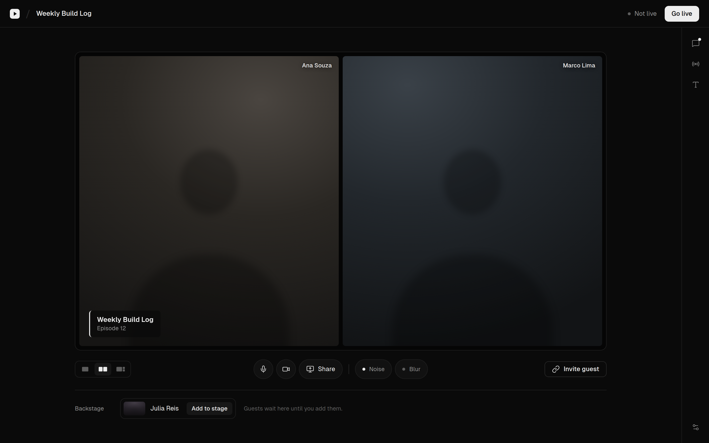

# Casthop

[](https://github.com/casthop/casthop/actions/workflows/ci.yml)
[](LICENSE)

Casthop is an open-source live studio that runs in the browser. A host signs in, guests join from a link with no account, up to six people sit on stage, and one composite goes out to several RTMP destinations with a recording kept.



## What it does today

In this tree:

- **Host studio and guest join.** Hosting is an account session (email magic link, optional GitHub). Guests join from a link, wait backstage, and do not need an account.
- **Stage and layouts.** Up to six people on stage. Solo, side-by-side, and screen-plus-cameras. Screen share, mic/camera toggles, and a lower-third banner.
- **Camera blur and noise suppression.** Background blur uses MediaPipe Selfie Segmenter on-device (loads only when blur is on, from this origin). RNNoise runs in an AudioWorklet before LiveKit publish.
- **One encode, several RTMP destinations.** LiveKit Egress transcodes once and fans out. Default local stand-ins for YouTube, LinkedIn, and X; custom `rtmp:` URLs are allowed. Per-destination status, crash retry with backoff.
- **Live waits for real output.** The studio pill stays on Starting until Egress is producing (stream bytes/duration, or a short settle after RTMP `started_at`). It is not Live just because the compositor process exists.
- **Recording.** Egress writes an MP4 of the composite (`data/recordings/` locally).
- **Studio chat and YouTube Live chat.** People in the room can chat. While live, the Worker can poll YouTube `liveChatMessages.list` and show those comments in the studio panel. Hosts and co-hosts can pin one onto the compositor overlay. Needs Worker secrets (`YOUTUBE_API_KEY` plus a live chat or video id, or a YouTube OAuth refresh token). Unset, the feature stays hidden and the studio does not error. X and LinkedIn comment APIs are not wired.
- **Co-hosts.** The owner can invite co-hosts by email.

Media plane: LiveKit (SFU) + Egress + Redis + an RTMP edge. Control plane: Cloudflare Worker, Durable Objects, D1. Browser media hot paths are Rust compiled to WASM in `crates/casthop-media`. Details: [Architecture](site/src/content/docs/architecture.mdx).

## Quick start

Linux with Docker host networking is the supported local path. Install [Bun](https://bun.com) 1.4+; do not use npm.

```bash
cp .env.example .env
cp .dev.vars.example .dev.vars   # Worker secrets, gitignored
mkdir -p data/recordings data/rtmp && chmod 777 data/recordings
docker compose up -d
bun install
bun run dev
```

Open [http://127.0.0.1:5173](http://127.0.0.1:5173). Email yourself a magic link (the Worker prints it in the console), open a studio, copy the guest link, put people on stage, Go Live. Optional GitHub OAuth and YouTube Live chat are Worker secrets in `.dev.vars`; see [Configuration](site/src/content/docs/configuration.mdx).

Default destinations are local MediaMTX stand-ins (`rtmp://127.0.0.1:1935/live/youtube`, `/live/linkedin`, `/live/x`). Health: [http://127.0.0.1:5173/api/health](http://127.0.0.1:5173/api/health).

Full local notes (Docker Desktop, no camera, rebuilding WASM): [Getting started](site/src/content/docs/getting-started.mdx). Tests and PR flow: [CONTRIBUTING.md](CONTRIBUTING.md).

## Self-hosting

Run LiveKit, Egress, Redis, and an RTMP edge yourself. Deploy the Worker (`wrangler deploy`) with D1 and Durable Objects. Put `LIVEKIT_API_SECRET` and a dedicated `HOST_KEY_SECRET` in Worker secrets, never in git. Generate real LiveKit keys (`lk generate-keys`); the published `devkey` is loopback-only.

See [Self-hosting](site/src/content/docs/self-hosting.mdx) and [Configuration](site/src/content/docs/configuration.mdx).

## Docs and site

The marketing site and docs are an Astro app in [`site/`](site/) (`cd site && bun install && bun run dev`). Recorded numbers live in [MEASUREMENTS.md](MEASUREMENTS.md).

## Contributing

See [CONTRIBUTING.md](CONTRIBUTING.md) and the [code of conduct](CODE_OF_CONDUCT.md). Issues labeled [`good first issue`](https://github.com/casthop/casthop/labels/good%20first%20issue) or [`help wanted`](https://github.com/casthop/casthop/labels/help%20wanted) are a good place to start.

## Security

See [SECURITY.md](SECURITY.md). Report vulnerabilities privately through [GitHub private vulnerability reporting](https://github.com/casthop/casthop/security/advisories/new).

## License

[AGPL-3.0-only](LICENSE). The server is the product. Hosted forks must share their changes.

`crates/vendor/nnnoiseless` is [BSD-3-Clause](crates/vendor/nnnoiseless/COPYING) (Xiph RNNoise via [nnnoiseless](https://github.com/jneem/nnnoiseless)).

Background blur vendors Google’s [MediaPipe Selfie Segmenter](https://github.com/google-ai-edge/mediapipe) landscape float16 model ([Apache-2.0](src/vendor/mediapipe/LICENSE)). Compatible with this repo’s AGPL-3.0-only license; the model stays Apache-2.0. `@mediapipe/tasks-vision` and its WASM runtime load only when blur is on, from this origin (no CDN).
